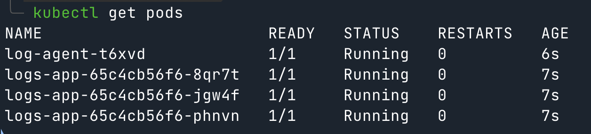
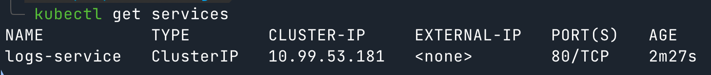
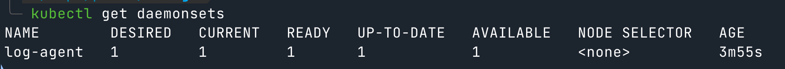
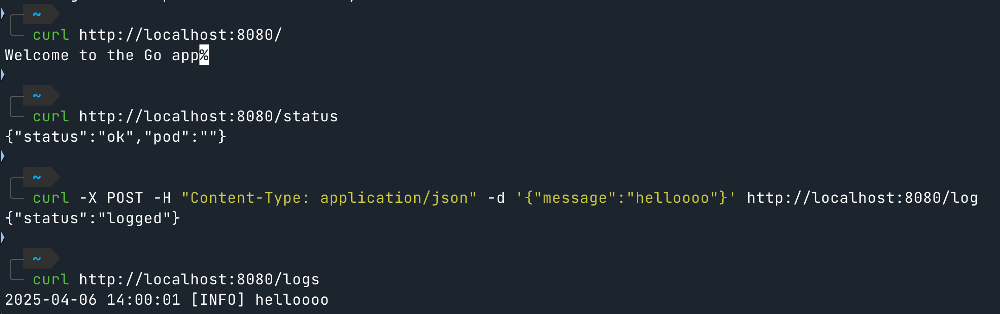
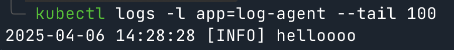
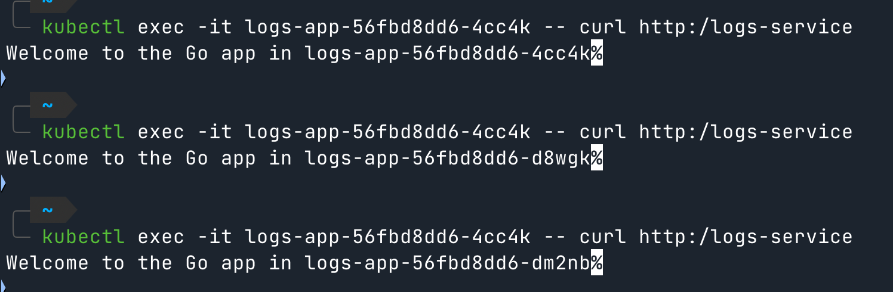

1. Start Minikube:
```bash
minikube start
```

2. Configure Docker:
```bash
eval $(minikube docker-env)
```

3. Build the Docker image:
```bash
docker build -t logs-app:latest .
```

4. Apply Kubernetes manifests using Kustomize:
```bash
kubectl apply -f k8s/deployment/
kubectl apply -f k8s/service/
kubectl apply -f k8s/daemonset/
```

5. Verify deployment:






6. Test the application:



7. Check log collection:



8. Test Load Balancing

```bash
kubectl exec -it logs-app-56fbd8dd6-4cc4k -- apk add curl
```



9. Test Failure Recovery

```bash
kubectl delete pod -l app=logs-app
pod "logs-app-56fbd8dd6-4cc4k" deleted
pod "logs-app-56fbd8dd6-d8wgk" deleted
pod "logs-app-56fbd8dd6-dm2nb" deleted

curl -X POST -H "Content-Type: application/json" -d '{"message":"helloooo 2"}' http://localhost:8080/log
{"status":"logged"}

kubectl logs -l app=log-agent --tail 100
2025-04-06 14:28:28 [INFO] helloooo
2025-04-06 14:44:41 [INFO] helloooo 2
```
